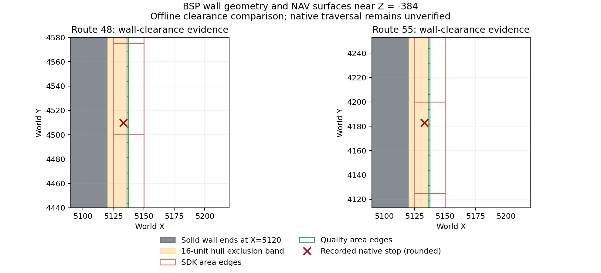
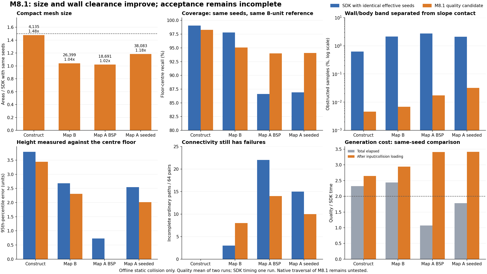

# M8 — exact SDK speed improvement and opt-in quality generation

The default SDK profile retains M7.1 NAV bytes, collision hashes and all 14 sample arrays on all four cases at 1 and 16 threads. The quality profile adds a canonical full-hull sampler, fitted surfaces, conservative merges, validated entity seeds and static BSP ladder records. This report separates measured offline results from native acceptance.

On Map A with BSP/entity seeds, reference coverage changes from 81.95% to 98.28%, with disconnected reference-connected pairs changing from 14 to 1. This gain has substantial costs: much larger NAVs and generation above the 2x timing aim. The three targeted high floors remain dependent on supplied seeds, and native acceptance is pending.

## SDK profile: exactness and speed

Part 1 is frozen at `work/m8/part1/` with a source manifest. Reverse obstacle traces run only for the retained successful span. A blocked-height skip requires a fixed point at least EPS inside every convex plane, respects saved collision bounds, and excludes ambiguous/one-sided cases. A trace early-out requires zero fraction with both solid flags already true. Tests compare the complete original trace/movement results, including thin corners, touching, overlapping obstacles and saved PHY bounds.

One early interval candidate kept NAV bytes but changed two Map B sample heights (70 to 71). It was rejected; the EPS-interior correction passes both byte and array checks. The rejected source and evidence remain under `work/m8/part1-candidate-1/`.

Warm uninstrumented local measurements follow. Construct at one thread uses the dedicated r1 run to exclude compilation. These are per-map observations, not statistical timing distributions. Site-instrumented runs are used only for trace counts.

| Case | Threads | Sampling before → after (s) | Total before → after (s) |
|---|---:|---:|---:|
| gm_construct | 1 | 5.437 → 3.854 | 17.324 → 15.263 |
| gm_construct | 16 | 3.803 → 3.288 | 11.935 → 11.500 |
| map_b | 1 | 32.122 → 21.456 | 119.800 → 107.074 |
| map_b | 16 | 24.510 → 16.101 | 68.480 → 58.085 |
| Map A BSP seeds | 1 | 20.998 → 12.789 | 68.895 → 62.678 |
| Map A BSP seeds | 16 | 16.715 → 9.858 | 50.259 → 44.560 |
| Map A supplied seeds | 1 | 30.246 → 20.282 | 104.462 → 94.326 |
| Map A supplied seeds | 16 | 30.358 → 15.236 | 85.783 → 65.932 |

Complete before/after phase times are in `reports/measurements/m8/sdk-summary.json`; the final integration parity matrix is `final-sdk-matrix.json`.

| Case | Sampling nodes | Traces before → after | Forward obstacle before → after | Reverse before → after | Ceiling before → after |
|---|---:|---:|---:|---:|---:|
| gm_construct | 146,563 | 8,180,733 → 6,421,235 | 886,675 → 12,693 | 885,568 → 52 | 518 → 518 |
| map_b | 653,329 | 45,957,394 → 31,556,371 | 8,081,398 → 1,722,881 | 8,047,369 → 4,863 | 24,733 → 24,733 |
| Map A BSP seeds | 519,768 | 38,136,824 → 24,308,161 | 7,210,242 → 549,886 | 7,171,914 → 3,607 | 32,059 → 32,059 |
| Map A supplied seeds | 804,334 | 54,942,128 → 37,794,469 | 8,921,695 → 635,426 | 8,865,590 → 4,200 | 37,633 → 37,633 |

`sdk-summary.json` also contains floor, adjacent, overlap, displacement, crouch and seed call counts and their per-node values. The original per-site JSONs retain call expressions and separate the selected-height retrace from ordinary forward probes.

## Independent quality audit

The reference enumerates canonical supported player origins directly from collision at 8-unit spacing; it takes no candidate or engine NAV as input. It uses half-width 16, crouch height 55, standing height 71, the case slope limit, direct/18-unit steps, swept up/across/down arcs up to 64 and drops below 400. Flooded origins come from the identical effective quality seed list for all three mesh audits. This is independent of NAV geometry, but shares the collision implementation and movement rules with quality generation; it is not an independent engine collision oracle.

Coverage uses XY containment with at most 18 units of Z difference. Height error uses the closest XY-overlapping area within 64 units; farther floors count as coverage misses. This association can count a nearby different floor as a large height error, so surface-to-supported-floor errors are also retained in JSON. Surface probes have spacing at most 8 and XY-area weights. Invalid surface means no fitting hull or an unwalkable support normal; unsupported distance above 18 is reported separately. Continuous whole-rectangle hull clearance is enforced during construction; support inside rectangles is sampled, and residual floor errors remain measurable.

Uncovered edge gaps are 3D distances to edge samples spaced at most 8 (distance overestimate at most 4). Sixty-four fixed pairs use RNG seed 20261026. Reference A* follows eight grid directions; a strongly connected component screen skips impossible searches without changing distances. Mesh A* uses directed portal-entry states and portal midpoints. It does not simulate steering, jumping physics or ladders. Zero-width/corner-only native transitions are excluded. Native path lengths and success rates are therefore separate evidence.

Portal verification tries the midpoint then samples at at most 8-unit spacing, and checks the reverse independently. Link counts below cover ordinary directional links; ladder records are listed separately. The unverified column counts failed probes only for positive-width portals. Total links minus verified and unverified gives links excluded for lacking such a portal. A verified link has a feasible witness, not proof that every point along its portal is traversable.

The Map B installed engine NAV belongs to an earlier BSP. Its comparison is historical, not a same-map engine acceptance test. BSP-size match flags are retained for every reference.

### gm_construct

Reference: 1,392,056 reachable origins, 69 effective seeds; 0/64 pairs are disconnected in the reference and excluded from mesh disconnection/stretch counts.

| Metric | SDK | Quality | Engine |
|---|---:|---:|---:|
| Recall | 98.77016% | 98.44101% | 98.54848% |
| Uncovered origins | 17,120 | 21,702 | 20,206 |
| Edge gap p50 / p95 / max | 16.125 / 61.920 / 167.064 | 2.750 / 5.806 / 14.736 | 18.001 / 83.165 / 139.181 |
| Invalid surface | 47.36506% | 0.00000% | 41.85462% |
| Hull-invalid surface | 47.36506% | 0.00000% | 41.85462% |
| Unwalkable support | 0.62085% | 0.00000% | 0.77763% |
| Unsupported within 18 | 0.65727% | 0.00000% | 1.10774% |
| Height error p50 / p95 / max | 0.626 / 6.656 / 63.941 | 0.004 / 0.228 / 4.600 | 0.665 / 6.852 / 63.993 |
| Areas with error >8 / >18 | 621 / 57 | 0 / 0 | 424 / 53 |
| Disconnected on reference paths | 1 | 1 | 1 |
| Stretched >1.25× / >2× | 0 / 0 | 1 / 0 | 0 / 0 |
| Stretch p50 / p95 / max | 0.968 / 1.045 / 1.126 | 0.985 / 1.055 / 1.292 | 0.973 / 1.060 / 1.122 |
| Links verified / unverified / total | 8,886 / 5,770 / 14,656 | 1,070,718 / 0 / 1,070,718 | 7,084 / 4,360 / 11,446 |
| Midpoint hull failures | 7,020 | 2,591 | 5,178 |
| One-way with walkable reverse | 0 | 0 | 1 |
| Areas | 2,753 | 106,119 | 2,271 |
| At most one profile cell | 112 (25 units) | 51,685 (12.5 units) | 108 (25 units) |
| At most 25×25 units | 112 | 71,100 | 108 |
| Mean ordinary degree | 5.324 | 10.090 | 5.040 |
| Ladder records | 0 | 0 | 1 |

### map_b

Reference: 5,841,677 reachable origins, 642 effective seeds; 14/64 pairs are disconnected in the reference and excluded from mesh disconnection/stretch counts.

| Metric | SDK | Quality | Engine |
|---|---:|---:|---:|
| Recall | 96.63826% | 98.17903% | 85.36716% |
| Uncovered origins | 196,382 | 106,375 | 854,803 |
| Edge gap p50 / p95 / max | 22.803 / 439.352 / 1,205.272 | 3.000 / 38.818 / 171.927 | 5,665.416 / 9,547.166 / 10,996.509 |
| Invalid surface | 24.69910% | 0.00035% | 19.84381% |
| Hull-invalid surface | 24.69827% | 0.00000% | 19.84287% |
| Unwalkable support | 1.50821% | 0.00035% | 1.58650% |
| Unsupported within 18 | 1.88001% | 0.00021% | 2.15137% |
| Height error p50 / p95 / max | 0.002 / 5.679 / 63.999 | 0.000 / 0.183 / 63.976 | 0.002 / 6.113 / 63.995 |
| Areas with error >8 / >18 | 7,301 / 2,742 | 29 / 26 | 5,039 / 2,581 |
| Disconnected on reference paths | 5 | 4 | 5 |
| Stretched >1.25× / >2× | 2 / 1 | 0 / 0 | 2 / 1 |
| Stretch p50 / p95 / max | 0.982 / 1.147 / 2.577 | 1.000 / 1.040 / 1.055 | 0.988 / 1.147 / 2.581 |
| Links verified / unverified / total | 69,375 / 42,891 / 112,266 | 3,291,056 / 0 / 3,291,056 | 43,912 / 23,732 / 67,705 |
| Midpoint hull failures | 50,806 | 2,928 | 28,359 |
| One-way with walkable reverse | 1 | 0 | 0 |
| Areas | 25,310 | 331,252 | 16,352 |
| At most one profile cell | 5,491 (25 units) | 204,287 (12.5 units) | 4,083 (25 units) |
| At most 25×25 units | 5,491 | 238,631 | 4,083 |
| Mean ordinary degree | 4.436 | 9.935 | 4.140 |
| Ladder records | 0 | 2 | 0 |

### Map A BSP seeds

Reference: 5,521,591 reachable origins, 1,327 effective seeds; 19/64 pairs are disconnected in the reference and excluded from mesh disconnection/stretch counts.

| Metric | SDK | Quality | Engine |
|---|---:|---:|---:|
| Recall | 81.95493% | 98.28412% | 82.87829% |
| Uncovered origins | 996,375 | 94,744 | 945,391 |
| Edge gap p50 / p95 / max | 318.001 / 2,528.494 / 8,863.365 | 3.001 / 40.846 / 170.168 | 278.000 / 1,143.339 / 2,257.299 |
| Invalid surface | 7.18195% | 0.00074% | 7.27159% |
| Hull-invalid surface | 7.18158% | 0.00000% | 7.27034% |
| Unwalkable support | 1.86277% | 0.00074% | 1.94043% |
| Unsupported within 18 | 2.61576% | 0.00018% | 2.74324% |
| Height error p50 / p95 / max | 0.002 / 1.296 / 63.944 | 0.000 / 0.000 / 64.000 | 0.002 / 1.534 / 63.944 |
| Areas with error >8 / >18 | 6,958 / 4,811 | 64 / 61 | 6,763 / 4,807 |
| Disconnected on reference paths | 14 | 1 | 14 |
| Stretched >1.25× / >2× | 0 / 0 | 0 / 0 | 0 / 0 |
| Stretch p50 / p95 / max | 0.974 / 1.053 / 1.106 | 0.996 / 1.076 / 1.188 | 0.974 / 1.055 / 1.106 |
| Links verified / unverified / total | 42,423 / 21,519 / 63,942 | 2,132,978 / 0 / 2,132,978 | 40,251 / 20,052 / 60,408 |
| Midpoint hull failures | 25,541 | 774 | 23,994 |
| One-way with walkable reverse | 3 | 0 | 3 |
| Areas | 17,208 | 211,236 | 16,573 |
| At most one profile cell | 5,026 (25 units) | 139,014 (12.5 units) | 5,055 (25 units) |
| At most 25×25 units | 5,026 | 152,495 | 5,055 |
| Mean ordinary degree | 3.716 | 10.098 | 3.645 |
| Ladder records | 0 | 17 | 0 |

### Map A supplied seeds

Reference: 7,878,459 reachable origins, 1,655 effective seeds; 40/64 pairs are disconnected in the reference and excluded from mesh disconnection/stretch counts.

| Metric | SDK | Quality | Engine |
|---|---:|---:|---:|
| Recall | 83.98484% | 98.37241% | 58.13515% |
| Uncovered origins | 1,261,748 | 128,229 | 3,298,305 |
| Edge gap p50 / p95 / max | 188.738 / 1,085.563 / 2,071.099 | 2.948 / 37.055 / 286.780 | 1,284.184 / 6,259.449 / 8,629.485 |
| Invalid surface | 21.15024% | 0.00071% | 7.27159% |
| Hull-invalid surface | 21.14999% | 0.00000% | 7.27034% |
| Unwalkable support | 1.42868% | 0.00071% | 1.94043% |
| Unsupported within 18 | 2.67901% | 0.00013% | 2.74324% |
| Height error p50 / p95 / max | 0.002 / 10.749 / 63.998 | 0.000 / 0.144 / 64.000 | 0.002 / 1.545 / 63.944 |
| Areas with error >8 / >18 | 15,268 / 7,326 | 65 / 62 | 6,786 / 4,811 |
| Disconnected on reference paths | 15 | 0 | 16 |
| Stretched >1.25× / >2× | 1 / 0 | 0 / 0 | 1 / 0 |
| Stretch p50 / p95 / max | 0.995 / 1.295 / 1.485 | 0.994 / 1.134 / 1.171 | 1.000 / 1.321 / 1.487 |
| Links verified / unverified / total | 79,439 / 52,707 / 132,146 | 4,016,185 / 0 / 4,016,185 | 40,251 / 20,052 / 60,408 |
| Midpoint hull failures | 61,324 | 1,641 | 23,994 |
| One-way with walkable reverse | 7 | 0 | 3 |
| Areas | 31,764 | 410,192 | 16,573 |
| At most one profile cell | 6,961 (25 units) | 268,520 (12.5 units) | 5,055 (25 units) |
| At most 25×25 units | 6,961 | 306,787 | 5,055 |
| Mean ordinary degree | 4.160 | 9.791 | 3.645 |
| Ladder records | 0 | 17 | 0 |

Construct is a measured tradeoff: recall falls by 0.329 percentage points versus SDK, and one pair has 1.292x stretch where SDK has none above 1.25x. It is retained for the much lower height error (p95 6.656 to 0.228 units), zero sampled hull-invalid surface, and much smaller uncovered-edge gaps. This is not a claim that every metric or every map improves.

Residual support errors remain. On Map A, the quality surface-to-supported-floor audit has a maximum error of 46.396 units even though p95 is about 0.002 in the BSP/entity case. Whole-rectangle hull clearance is continuous; floor support is sampled. Tiny unsupported/unwalkable surface fractions and the nearest-floor association outliers in the tables must not be described as perfect height fidelity.

## Runtime and size tradeoff

Quality times are r1 warm repeats with the frozen final candidate, run sequentially without concurrent audit jobs. The first-run r0 values and full phase breakdown are preserved. Both repeats must produce the same NAV hash.

| Case | SDK 16-thread total (s) | Quality warm total (s) | Ratio | Quality sampling / fitting+merging / connections (s) |
|---|---:|---:|---:|---:|
| gm_construct | 10.817 | 79.969 | 7.39× | 21.779 / 37.103 / 12.387 |
| map_b | 54.425 | 209.275 | 3.85× | 65.512 / 73.200 / 35.302 |
| Map A BSP seeds | 40.489 | 133.787 | 3.30× | 27.793 / 36.367 / 25.300 |
| Map A supplied seeds | 60.415 | 239.577 | 3.97× | 61.082 / 76.351 / 44.546 |

Both Map A quality runs miss the at-most-2× SDK timing aim. The BSP/entity case takes about 3.30× the final SDK run. The profile remains opt-in; native load time, memory and pathing cost from its much larger mesh remain unmeasured.

## Candidate decisions

- Retained: canonical level flood and full-hull surface fitting. The 12.5-unit shared-corner trial repaired the connectivity loss of independent per-node plane fits. All trials and rejected sources remain in `work/m8/quality-stage-*`.
- Retained: strict merges and exact flat-surface regrouping. Matching attributes, complete edges, reciprocal movement, water boundaries and NO_MERGE are protected. Original corner constraints survive the first tiling and later chained merges. Flat regrouping preserves the exact union, including holes; protected ladder endpoint regions are excluded.
- Rejected: the first per-node quality trials. Construct produced excessive fragmentation and 12–13 disconnected reference pairs. Correcting cardinal directions and duplicate epsilon origins alone did not fix the topology.
- Evaluated 25-unit quality sampling: it was faster on Construct, but coverage fell from about 98.44% to 97.80%, and disconnected pairs rose from 3 to 4 in the same base-seed audit. The finer 12.5-unit profile was retained.
- Retained: validated BSP entity floors, including ladder landings. Rejected: the broad nearby-floor sweep; Map A reached the 4,096-seed cap after 25,083 probes, included roofs/disconnected spaces and still missed the desired high floors. The losing sweep was removed from production.

## Seed discovery and ladders

- gm_construct: 36 validated entity floors, 69 effective seeds; discovery limit reached: False. Ladders: 0/1 records written; 1 skipped.
- map_b: 634 validated entity floors, 642 effective seeds; discovery limit reached: False. Ladders: 2/7 records written; 5 skipped.
- Map A BSP seeds: 1,289 validated entity floors, 1,327 effective seeds; discovery limit reached: False. Ladders: 17/17 records written; 0 skipped.
- Map A supplied seeds: 1,398 validated entity floors, 1,655 effective seeds; discovery limit reached: False. Ladders: 17/17 records written; 0 skipped.

Complete seed positions, source classes, 128-unit height bands and BSP leaf areas are in each generation JSON. Sky-camera leaf areas are included for comparison. Entity discovery can still add roofs and enclosed rooms and does not infer door permissions. The previously supplied high floors near Z 4352/6912/2048 are not guaranteed by entity discovery; the seeded case remains distinct.

Ladder endpoint fields from `func_useableladder` are already in world coordinates; applying the entity origin again would be wrong. V16 records use the SDK top-forward/left/right/behind/bottom ordering. Every emitted record has reciprocal area references, a usable non-behind top slot and a geometric climb/dismount witness; widths are capped at 32. Unsupported swimming approaches, dynamic/parented entities and missing landings are skipped. Native loading and NextBot ladder use remain open.

### What expanded seeds actually add

On the identical 8-unit lattice, Map A BSP/entity seeds add 196,126 reachable origins (5,325,465 to 5,521,591), losing 0. Of 1,289 accepted floor probes, 59 have a sky surface overhead and 1,230 have solid overhead; none shares the sky-camera leaf area. Ninety-four accepted roots were unreachable from the base seeds: 26 have open/sky overhead, and 68 have solid overhead. These are roof/outdoor and enclosed/disconnected-space candidates, respectively; overhead rays do not identify semantic roofs or sealed rooms. Full provenance is in `seed-evidence-map_a-bsp.json`.

| Target Z (±18) | Fitting reference origins | Reachable, base seeds | Reachable, BSP/entity seeds |
|---:|---:|---:|---:|
| 2048 | 60,854 | 0 | 0 |
| 4352 | 286,857 | 0 | 0 |
| 6912 | 411,988 | 0 | 0 |
| 7936 | 39 | 0 | 39 |
| 8192 | 570 | 0 | 568 |

Thus entity discovery does **not** solve the targeted floors near Z 2048, 4352 and 6912. Retaining it is justified by added reachable space and supported ladder landings, while the supplied-seed profile is still required for those floors.

Construct has candidate areas at both ends of its ladder, but no clear climb/reciprocal dismount combination was accepted. Map B writes one `info_ladder` and its `func_useableladder`; three other sources lack bottom candidates, one lacks both ends, and one has candidates but no accepted clear climb. These are conservative attachment failures, not evidence that the native ladders are unusable. The detailed skipped records retain Hammer IDs.

## Eight native failures

See `reports/measurements/m8/routes-final.json` for collider bounds, supported full-hull heights, nearby portals and route comparisons. The offline portal graph does not reproduce the native path exactly, so nearby portal evidence is not presented as a captured native path.

| Route | Offline observation at the recorded stop | Quality treatment / remaining check |
|---:|---|---|
| 17 | Sloping world brush bounds (-1232,-2560,0)–(-976,-2048,128); the local SDK surface cuts into the full hull on the ramp. | Refit/split against the full-hull floor; confirm native steering on the new surface. |
| 32 | A low PHY obstacle spans approximately (-1032,-787,128.25)–(-1009,-753,136.25), at the stopped height. | Retain only fitted surfaces and verified connections; native step behavior remains unproven. |
| 38 | Wall ends at Y=848; the rounded stop is Y=861. Nearby SDK areas begin only two units from the wall. | Keep the entire 16-half-width origin surface clear of the wall; rerun the doorway/corner. |
| 44 | Wall ends at X=-48; rounded stop X=-35. The stop is outside the nearest large SDK rectangle. | Clear portal surfaces reduce unsafe corner placement; look-ahead steering still needs native validation. |
| 48, 55 | Both stop at X=5133 beside the same wall ending at X=5120, spanning Y=3408–5824. SDK strips start at X=5125, inside the full-hull exclusion band. | Trim the unsafe strips and rebuild verified portals. Native route success is not inferred from this geometry fix. |
| 49 | The bot is at Z=128 below the Z=384 goal, against geometry ending at X=1728 (rounded stop X=1741). | Rebuild safe vertical connections and entity ladder landings; capture the native fall/segment type during rerun. |
| 54 | The same wall begins at X=5040; rounded stop X=5027 on its opposite side. | Enforce the 16-unit clearance on both sides and retest the corner. |

The approximately 13-unit separations match the [SDK HUMAN_HULL dimensions](https://raw.githubusercontent.com/ValveSoftware/source-sdk-2013/be57e3d01ac7d7aa6a2cacbfef187c0b46616db0/src/game/server/ai_hull.cpp). This is an inference from rounded stop coordinates, not a readback of the native bot hull. The harness sets a model and collision group but does not record its collision bounds. No failure is assigned to a bot or harness limit without native evidence.

The quality floor at this wall is a narrow safe strip. Removing unsafe SDK surface does not establish a successful native route. The offline route graph gives the following lengths after snapping each endpoint to the nearest surface; it excludes ladders and zero-width portals. These are model diagnostics, not native success predictions.

| Existing failed route | SDK offline length | Quality offline length |
|---:|---:|---:|
| 17 | 5,238.377 | 4,704.733 |
| 32 | 1,570.039 | 1,580.719 |
| 38 | n/a | n/a |
| 44 | n/a | 31,620.601 |
| 48 | n/a | 30,163.890 |
| 49 | 1,208.516 | 1,147.736 |
| 54 | n/a | 29,040.592 |
| 55 | n/a | 27,888.063 |

Route 38 still has no path in this offline quality graph. Routes 44, 48, 54 and 55 have long detours (roughly 28–32 thousand units). The 64 random reference pairs do not expose every local limitation. These cases remain explicit native investigation targets; the eight failures are not claimed fixed.

## Validation

79 tests pass (57 existing, six exact-SDK regressions and sixteen quality tests). The final SDK matrix verifies four cases at both thread counts. Warm quality repeats have identical bytes, and Map A BSP quality also has identical NAV bytes at 1 and 16 threads. Each staged NAV is v16/0, has analyzed=1 and recomputed hiding spots, and round-trips exactly. Ladder and area-reference validation runs before output replacement.

`work/m8/routes_quality.json` contains 114 routes in `[sx,sy,sz,gx,gy,gz,timeout,reach]` format: eight original failures, sixteen local failure probes, thirty-four two-way ladder checks, thirty-two changed portals and twenty-four merged-surface paths. All endpoints lie on the quality mesh; 74 routes also have both endpoints on the SDK mesh. Metadata records the remaining coverage differences. The existing 60 main and 30 upper routes should also be rerun natively. Native success, native ladder load/use and native performance are not established by these offline checks.

Staged meshes: `map_a-quality.nav` (supplied seeds), `map_a-bsp-quality.nav` (BSP plus validated entity floors), `map_b-quality.nav` and `gm_construct-quality.nav`.

The final source snapshot has 42 files; all Python sources match the frozen candidate used for generation and the 79-test run. Its only later change is README documentation. Part 1 retains a separate 34-file snapshot.

| Staged mesh | Bytes | Areas | Hiding spots | Ladders |
|---|---:|---:|---:|---:|
| gm_construct-quality.nav | 15,290,966 | 106,119 | 4,577 | 0 |
| map_b-quality.nav | 47,500,128 | 331,252 | 12,752 | 2 |
| map_a-bsp-quality.nav | 30,501,476 | 211,236 | 12,416 | 17 |
| map_a-quality.nav | 58,629,571 | 410,192 | 18,463 | 17 |

Collision limitations remain: configured mount precedence may differ from the running game; missing PHYs use the existing skip policy; non-brush model entities, Lua collision and dynamic gameplay state are not reconstructed. Quality safety and metrics are relative to that collision scene.

# M8.1 — compact candidate and fair audit (2026-10-26)

**Acceptance remains incomplete.** This candidate fixes the area/file-size explosion, preserves default SDK bytes and validates the native-length model. It improves floor-centre recall on both Map A cases, wall clearance and height accuracy on all four cases, and emits only geometrically verified links. It loses recall on Construct and Map B, worsens Map B connectivity, loses one Map A ladder landing and retains long difficult routes. The final quality meshes are staged for review and native testing; they are not an accepted replacement.

This section supersedes M8’s quality rankings and offline-path conclusions where the measurement convention or path model changed. The original M8 text and artifacts are retained unchanged.

## What changed

The quality profile now starts from SDK rectangles, fills missing regions with an independent 25-unit full-hull flood, and refines near obstacles or height changes down to 12.5 units. Flat open regions are retiled into larger rectangles. The 8-unit fitted-height tolerance was selected from local trials and checked against measured floor-centre errors below. Headroom uses the measured positive fitting residual rather than granting the whole tolerance as clearance. Necessary directed connections and selected seed/ladder anchors survive thin-area pruning; this preservation guarantee applies to retained anchors, not to every old fine-grid node.

The two height conventions are explicit: the NAV surface follows the floor beneath the area centre, while a full box on a slope needs a raised supported origin. Wall/body-band probes exclude step and slope contact. Link witnesses use the supported hull origin. SDK seed discovery is available through `--seed-discovery entities`; the SDK default remains `none`, and quality defaults to `entities`. Supplying the identical effective list through `--seeds` provides the fair SDK control.

The default SDK collision, sampler and area builder are unchanged from `62dee41c4597b5fe715d81373102edc93bbc1a8f`. The frozen final source contains 49 files; runtime fingerprint `3fda759734b58f6c7263ac71cbc158b96559e6f4d4253dcd9edbaf290eff085d`. Losing global fine-grid, speculative clipping and blocked-surface proof trials remain in local evidence; they are not active in the candidate.

## Size gate

| Case | SDK base areas | SDK same-seed areas | Quality areas | Quality bytes | Areas / same-seed SDK | Bytes / same-seed SDK |
| --- | --- | --- | --- | --- | --- | --- |
| gm_construct | 2,753 | 2,797 | 4,135 | 518,166 | 1.478x | 1.472x |
| Map B | 25,310 | 25,364 | 26,399 | 3,309,822 | 1.041x | 1.046x |
| Map A BSP | 17,208 | 18,319 | 18,691 | 2,333,112 | 1.020x | 1.018x |
| Map A supplied seeds | 31,764 | 32,156 | 38,083 | 4,769,853 | 1.184x | 1.184x |

`release-size-gate.json` passes the 1.5x area and byte limits against SDK with identical effective seeds, plus absolute caps of 26,000 Map A BSP areas and 48,000 seeded areas. This is a hard gate on these staged artifacts, not a runtime cap on arbitrary future CLI generation. Against the original base-seed SDK, Construct is 1.502x areas (4,135 versus 2,753), six areas above the floor of a strict 1.5x cap; its bytes are 1.494x. The other cases fit both base and equal-seed size comparisons.

The M8 area counts were 106,119 / 331,252 / 211,236 / 410,192. The new counts are 4,135 / 26,399 / 18,691 / 38,083; the seeded file falls from 58,629,571 to 4,769,853 bytes.

## Fair coverage and height measurements

All comparisons use the same collision scene, effective seeds and saved independent 8-unit reference. Floor-centre recall excludes invalid or more-than-64-unit-away centre-floor projections; each JSON records exclusions and both denominators. Coverage uses an 18-unit height tolerance. Reported height precision samples each mesh surface independently; recall and precision denominators therefore differ.

| Case | SDK same-seed centre recall | Quality centre recall | Delta | SDK full-support recall | Quality full-support recall |
| --- | --- | --- | --- | --- | --- |
| gm_construct | 99.058% | 98.290% | -0.768 pp | 98.826% | 98.087% |
| Map B | 97.807% | 95.066% | -2.741 pp | 96.647% | 94.290% |
| Map A BSP | 86.619% | 94.014% | +7.395 pp | 85.055% | 92.947% |
| Map A supplied seeds | 86.907% | 94.065% | +7.158 pp | 84.426% | 92.004% |

| Case | Centre height p95 SDK / quality | Full-support height p95 SDK / quality | Wall/body band SDK / quality | Adjusted invalid SDK / quality |
| --- | --- | --- | --- | --- |
| gm_construct | 3.7948 / 3.4417 | 6.6728 / 6.7647 | 0.6291% / 0.0046% | 0.6547% / 0.0223% |
| Map B | 2.6796 / 2.3099 | 6.4552 / 6.3741 | 2.1437% / 0.0069% | 2.2318% / 0.0436% |
| Map A BSP | 0.7272 / 0.0003 | 1.3606 / 0.3655 | 2.7215% / 0.0172% | 2.8078% / 0.0748% |
| Map A supplied seeds | 2.5431 / 2.0181 | 10.3651 / 9.9829 | 2.0984% / 0.0323% | 2.1695% / 0.0782% |

| Case | Strict full-box invalid SDK / quality | Slope-contact-only SDK / quality | Centre reference points / excluded |
| --- | --- | --- | --- |
| gm_construct | 48.02% / 49.01% | 40.59% / 42.04% | 1,379,659 / 12,397 |
| Map B | 24.67% / 23.70% | 16.42% / 17.25% | 5,791,165 / 50,512 |
| Map A BSP | 7.41% / 4.16% | 2.88% / 2.63% | 5,464,052 / 57,539 |
| Map A supplied seeds | 21.17% / 17.89% | 17.01% / 15.87% | 7,752,308 / 126,151 |

The strict surface-plus-0.01 full-box test is retained as a diagnostic, not a standalone quality ranking. For example, Construct’s equal-seed SDK is about 48% invalid under that placement, but only about 0.65% invalid after support adjustment. A full box cutting into the uphill floor is not equivalent to hitting a wall. The lateral band is an obstruction proxy and does not reconstruct every native mask, posture or steering decision.

| Case | Centre unsupported within 18, SDK / quality | Largest measured centre error, SDK / quality |
| --- | --- | --- |
| gm_construct | 0.0281% / 0.0198% | 394.22 / 394.04 units |
| Map B | 0.0986% / 0.0111% | 399.27 / 399.02 units |
| Map A BSP | 0.1050% / 0.0047% | 257.53 / 236.85 units |
| Map A supplied seeds | 0.0870% / 0.0082% | 257.53 / 236.85 units |

The 8-unit fitting tolerance applies to generation probes, not a continuous bound at every surface point. Rare large height errors and unsupported samples remain in the independent audit; the p95 improvement must not be read as a guarantee that every area is correct. Long downward probes can also match a different floor, so the raw JSON retains invalid and different-floor counters.

| Case | SDK base centre recall | SDK equal-seed centre recall | Gain from seeds alone | Quality gain over equal-seed SDK |
| --- | --- | --- | --- | --- |
| gm_construct | 99.002% | 99.058% | +0.056 pp | -0.768 pp |
| Map B | 97.797% | 97.807% | +0.011 pp | -2.741 pp |
| Map A BSP | 83.437% | 86.619% | +3.182 pp | +7.395 pp |
| Map A supplied seeds | 86.446% | 86.907% | +0.461 pp | +7.158 pp |

Entity-seed provenance is retained separately. It can add roofs or enclosed rooms and does not infer gameplay access or door permission. The supplied-seed Map A case remains necessary for its upper floors.

## Links and connectivity

| Case | Quality directed links | Zero-width/disjoint | Verified / total | Missing walkable reverse | Incomplete reference paths SDK / quality |
| --- | --- | --- | --- | --- | --- |
| gm_construct | 21,915 | 1,107 | 21,915 / 21,915 | 0 | 0 / 0 of 64 |
| Map B | 108,383 | 5,577 | 108,383 / 108,383 | 0 | 3 / 8 of 64 |
| Map A BSP | 59,346 | 2,768 | 59,346 / 59,346 | 0 | 22 / 14 of 64 |
| Map A supplied seeds | 149,327 | 7,563 | 149,327 / 149,327 | 0 | 15 / 10 of 64 |

All emitted quality links have a swept full-hull witness under the generator’s 64-unit jump / 400-unit drop geometry limits. The ordinary-path audit uses native default costs and 18/58/200 step/jump/drop limits; a geometric witness is not a guaranteed native transition. Ladder/elevator edges are excluded from this path graph. The reference shortest-distance ratio is diagnostic because the native area-centre cost and fine-grid distance optimize different objectives. Map B’s 3-to-8 incomplete-pair regression is a failed acceptance criterion.

## Native path semantics and validation

The revised model follows directed CNavArea links even when portals touch only at a corner or have no width. It reproduces Source portal clamping, edge-only 25-unit margins, area-centre costs, float32 accumulation, jump penalties, path-detail drops/climbs and partial-path termination. Starts settle from the harness’s +4 offset. Nearest-area selection is geometric and omits runtime visibility and blockers. Ordinary connections are modeled; ladders, elevators, physics and custom Lua costs are not. The implementation follows the pinned [Valve navigation path source](https://github.com/ValveSoftware/source-sdk-2013/blob/be57e3d01ac7d7aa6a2cacbfef187c0b46616db0/src/game/server/nav_pathfind.h) and [NextBot path construction](https://github.com/ValveSoftware/source-sdk-2013/blob/be57e3d01ac7d7aa6a2cacbfef187c0b46616db0/src/game/server/NextBot/Path/NextBotPath.cpp).

| Recorded dataset | Routes | Maximum relative length error |
| --- | --- | --- |
| bsp | 60 | 0.1003% |
| engine | 60 | 0.1003% |
| m6 | 60 | 0.1003% |
| m6bsp | 60 | 0.1003% |
| upper | 30 | 0.4291% |
| Run6 SDK | 60 | 0.1003% |
| Run6 M8 quality | 60 | 0.1426% |

All 270 original and 120 Run6 records are within 5%; the largest error is 0.4291%. Per-route values are retained in `native-lengths.csv`, `path-native-validation.json` and `native-m8-run6.json`. This validates recorded path construction lengths, not successful native movement.

Routes 38, 44, 48, 54 and 55 on the SDK/engine mesh are **valid partial paths**, with `complete=false`. The short 1,187–3,859-unit lengths end near a wall and include the requested destination in path details; they do not establish a traversable shortcut. The harness ignores the boolean returned by `Path:Compute` and checks only `IsValid`. The [Facepunch API documentation](https://wiki.facepunch.com/gmod/PathFollower%3ACompute) permits a valid partial path when computation returns false. Future native captures should record both values.

### Ordinary-path cost proxy

| Mesh, 60 main routes | Complete | A* expansions median / p95 / max | Warm A* ms median / p95 / max |
| --- | --- | --- | --- |
| engine | 55/60 | 5.5 / 744.6 / 1,118 | 0.0146 / 0.2735 / 0.3664 |
| sdk-base | 55/60 | 5.5 / 912.3 / 1,355 | 0.0145 / 0.3153 / 0.3807 |
| sdk-equal | 55/60 | 5.5 / 918.0 / 1,355 | 0.0117 / 0.3118 / 0.3393 |
| m8-bsp | 59/60 | 90.5 / 15984.1 / 17,322 | 0.3225 / 7.1436 / 8.9305 |
| m8-seeded | 59/60 | 90.5 / 15984.1 / 17,322 | 0.6635 / 8.9214 / 11.7706 |
| quality-map_a-bsp | 59/60 | 7.5 / 1622.2 / 1,855 | 0.0104 / 0.3910 / 0.4724 |
| quality-map_a-seeded | 59/60 | 7.0 / 1626.2 / 1,882 | 0.0153 / 0.4029 / 0.4574 |

Warm A* times are the median of three executions per route. They exclude graph building, nearest-area selection, detailed path construction and native engine/Lua overhead; expansions are the more portable proxy. Main-route worst-case expansions fall from 17,322 on M8 to 1,855/1,882 on compact BSP/seeded meshes. On 30 upper routes, completeness is 25 for the same-seed BSP SDK, 23 for compact BSP quality, and 29 for compact seeded quality; the BSP upper-route result is a regression and the seeded result depends on its additional input seeds.

## Run6 failures and the compact candidate

| Route | SDK native result / length | M8 native result / length | M8.1 modeled length | M8.1 complete |
| --- | --- | --- | --- | --- |
| 17 | stuck / 12,999 | stuck / 4,411 | 14,908.6 | True |
| 32 | timeout / 1,636 | timeout / 1,807 | 3,251.0 | True |
| 38 | timeout / 2,266 | timeout / 2,102 | 2,197.2 | False |
| 43 | reached / 5,984 | timeout / 2,978 | 5,564.1 | True |
| 44 | timeout / 2,206 | stuck / 33,468 | 40,059.3 | True |
| 48 | timeout / 3,859 | stuck / 31,794 | 38,777.6 | True |
| 49 | timeout / 1,094 | timeout / 1,148 | 1,176.3 | True |
| 51 | reached / 2,771 | timeout / 2,499 | 2,866.9 | True |
| 54 | timeout / 2,537 | stuck / 30,256 | 26,546.3 | True |
| 55 | timeout / 1,187 | stuck / 29,389 | 35,904.9 | True |
| 56 | reached / 6,179 | stuck / 6,399 | 6,311.3 | True |

The M8 stop positions for routes 17, 32, 43, 44, 48, 54 and 55 are within roughly 0.9–11.7 units of modeled climb transitions rising about 40–57 units. Route 43 is a failed short climb shortcut, not evidence of an excessively long wall-trim detour. The plain `sdk`/`q` harness labels do not enable its explicit jump helper; only `agile` labels do. Source’s [PathFollower ledge handling](https://github.com/ValveSoftware/source-sdk-2013/blob/be57e3d01ac7d7aa6a2cacbfef187c0b46616db0/src/game/server/NextBot/Path/NextBotPathFollow.cpp) still performs local ledge checks, while the SDK base [NextBotGroundLocomotion::ClimbUpToLedge](https://github.com/ValveSoftware/source-sdk-2013/blob/be57e3d01ac7d7aa6a2cacbfef187c0b46616db0/src/game/server/NextBot/NextBotGroundLocomotion.cpp) returns false. GMod’s runtime override and actual actor hull were not read back. These are strong traversal clues, not proof that a missing helper alone caused the failures.

Route 51’s stop and closest M8 path segment project to a triangle whose normal Z is 0.51961, below the configured 0.55 slope threshold. Adjacent M8 path points rise 17–29 units above the centre floor, and bounded local support probes fail at one point for both 26- and 32-wide hulls. This is a full-support surface / local slope discrepancy; native posture, slope limits and steering remain unverified. The compact mesh changes the route from 2,499 to a modeled 2,867 units.

Route 56 stops about 8.2 units sideways from the M8 path. At the path, the 26-wide supported hull rests near Z128.04, while the 32-wide hull contacts a low obstacle near Z137.04; both 55- and 71-high hulls fit there. Neither width finds a fitting origin in the bounded probes at the rounded stopped XY. This distinguishes a local support/steering boundary from a low-ceiling-only explanation. Compact quality follows the Z128 centre floor nearby, but native movement is still untested. Exact probes, normals, nearby points and ladder diagnostics are in `native-regression-diagnostics.json`.

Among the 49 routes reached by both old native meshes, M8/SDK path length has median 1.033x and maximum 1.334x; 17 are more than 10% longer. Compact M8.1 predictions still have median 1.049x and 17 more than 10% longer. Area-centre A* costs, jump penalties and portal margins depend on tessellation; reducing area count does not guarantee a shorter detailed path. The four long complete detours remain 26.5–40.1k units. Their SDK comparison paths were incomplete, but the detours still require native traversal validation.

The Run6 native capture reports SDK 52 reached / 1 stuck / 7 timed out, versus M8 49 / 6 / 5. Native median compute time rises from 0.03 to 0.45 ms, and maximum from 0.67 to 22.28 ms. Separately, the 410,192-area mesh hung during reload for over 19 minutes at about 2.1 GB before the client was killed. That observation motivates the hard size gate; no stack or GMod reload implementation was captured, so a quadratic teardown cause is not established. The SDK area destructor has a reset bypass, which prevents inferring reload complexity from its notify-all loop alone.

## Ladders and fixtures

Construct writes 0/1 ladder sources, Map B 2/7, and both Map A profiles 16/17. One Map A ladder is missing: its old M8 top witness near (-12858.25, 818.76, -638.97) is outside the compact mesh. The bottom witness remains covered. The only compact top candidate is behind the ladder; reverse-facing trials fail bottom movement. The ladder was already absent before graph pruning, so this is a coarse landing-coverage regression, not pruning loss. Preserving existing ladder anchors cannot recreate a landing the coarse generation omitted. All 17 old M8 ladders loaded in Run6; that does not validate compact ladder loading or traversal.

`work/m8_1/routes_quality.json` now contains 126 routes, retaining all 114 M8 fixtures and adding 12 new same-seed coverage probes. The eight original failure coordinates are unchanged. Other covered endpoints follow the new floor-centre surface, with starts +4. Only 71 routes have both endpoints covered by this candidate; historical and missing-ladder fixtures remain explicitly flagged rather than being silently removed. 101 have complete ordinary-path predictions; ladder/elevator edges are omitted. The metadata identifies every retained uncovered endpoint.

## Generation time and remaining cost

| Case | SDK base seconds | SDK same-seed seconds | Quality mean seconds | Quality / base | Quality / same-seed |
| --- | --- | --- | --- | --- | --- |
| gm_construct | 10.824 | 8.680 | 20.185 | 1.865x | 2.325x |
| Map B | 57.735 | 56.054 | 136.749 | 2.369x | 2.440x |
| Map A BSP | 44.313 | 100.410 | 107.224 | 2.420x | 1.068x |
| Map A supplied seeds | 87.793 | 95.010 | 169.505 | 1.931x | 1.784x |

These are isolated sequential warm processes at 16 threads. Quality uses the mean of two identical-output runs; each SDK timing is one run. Initial warm-up runs are excluded. Same-seed SDK uses the explicit effective-seed file and excludes discovery preprocessing; quality includes discovery. A separate SDK `--seed-discovery entities` Map A BSP run took 68.484 seconds and exactly matched the explicit-seed output. The extra fair timing pass prevents assigning seed-expansion cost to the sampler. Timing is host- and cache-dependent.

| Case | SDK same-seed after input/collision | Quality after input/collision | Ratio |
| --- | --- | --- | --- |
| gm_construct | 6.946 s | 18.391 s | 2.648x |
| Map B | 41.584 s | 122.515 s | 2.946x |
| Map A BSP | 26.313 s | 89.780 s | 3.412x |
| Map A supplied seeds | 44.562 s | 152.210 s | 3.416x |

Collision loading varied enough to distort a single total-time ratio: the final same-seed BSP and seeded controls spent 73.98 and 50.33 seconds in collision loading, versus about 17 seconds in the quality repeats. No other audit or generation was run by this task during the timing passes, but system-wide cache and concurrent-work effects were not controlled. Subtracting the recorded input/collision stages exposes 2.65–3.42x remaining work. This is a derived stage comparison, not an additional benchmark. A uniform 2x performance pass is not established, and the slow SDK loading must not be used to claim one.

Relative to base seeds, Map B and Map A BSP exceed 2x. For the Map A BSP quality run, the main mean costs are rectangle refinement 24.49 s, collision loading 17.32 s, inherited SDK connections 16.63 s, SDK sampling 10.39 s, independent patch sampling 8.50 s and quality reconnection 7.75 s. Seeded refinement takes 33.53 s and inherited connections 30.42 s. The conservative design currently pays for an SDK skeleton plus an independent coverage pass and repeated exact hull checks. These are measured costs, not an irreducible lower bound; reducing them safely remains work. Cached or concurrent exploratory timings are not used for acceptance.

## Verification

The frozen final suite passes all 88 tests. An initial snapshot run hit a missing scratch `work/` directory in a legacy fixture; creating that directory allowed the unchanged tests to pass, and both logs are retained. The 4-case x 1/16-thread default SDK matrix is byte-identical to accepted M8 Part 1. Quality repeats are byte-identical for all four cases, and Map A BSP quality is identical at 1 and 16 threads. All four equal-seed SDK controls match their earlier frozen controls exactly. Each staged NAV is validated and round-tripped by the generator.

| Staged file | Areas | Bytes | SHA256 |
| --- | --- | --- | --- |
| gm_construct-quality.nav | 4,135 | 518,166 | e478d0362890f7a18f6bc2ae7b9f22eb38f0b08026ec7c9051c1d4835d84de7e |

Reproducing the audits requires the large 8-unit reference caches, game assets and earlier NAV inputs, which are not distributed.

Source verification compares all 49 files against the frozen candidate and verifies the SDK core against HEAD.

Acceptance still requires resolving the Construct/Map B recall loss, Map B connectivity loss, BSP upper-route regression and missing Map A landing, then testing the compact meshes natively. The CLI quality profile remains experimental. Static collision still omits runtime door/model/Lua state and uses the existing missing-PHY skip policy. No result here establishes native steering, crouching, ladder traversal, loading or reload performance.
